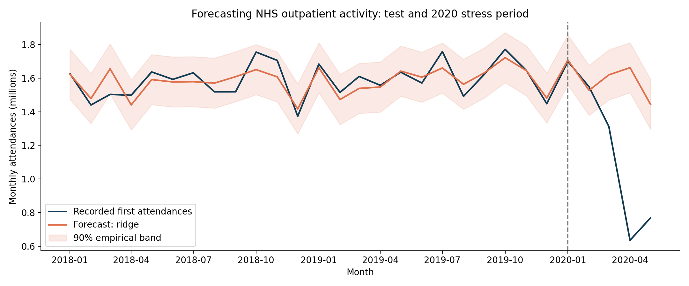

# Hospital Appointment Activity Forecasting

I wanted to explore how well we can forecast hospital outpatient activity using past monthly figures. This project uses real NHS England aggregate data and compares five forecasting approaches. I also checked what happened when activity changed sharply in 2020.

## Verified historical results
Ridge was selected on 2016 to 2017 validation data. On 24 locked test months in 2018 to 2019, its MAE was **50,083 attendances**, versus **62,501** for seasonal naive: **19.9% lower error**. This is a descriptive comparison, not a statistical-significance claim.

| Model | MAE (attendances) | WAPE |
|---|---:|---:|
| ridge | 50,083 | 3.15% |
| random_forest | 51,463 | 3.24% |
| seasonal_drift | 56,848 | 3.58% |
| seasonal_naive | 62,501 | 3.94% |
| last_month | 139,086 | 8.76% |




On January to May 2020, Ridge WAPE rose to **34.21%** and empirical-band coverage fell from **23/24** to **2/5**. Last-month forecasting adapted more quickly in this short stress period. Better historical performance did not imply resilience to a large structural break.

## Why I explored this
My work in resource planning made me interested in how forecasts could support staffing and capacity decisions. What I found useful here was seeing both the improvement in normal periods and the failure during disruption. This project does not show a reduction in waiting times or staffing costs.

## Reproduce
Tested with Python 3.12 on CPU. From this directory:
```bash
python -m venv .venv
source .venv/bin/activate
pip install -r environment-lock.txt
python run.py
python -m unittest discover -p "test_*.py" -v
```
The script downloads the official workbook if absent, generates predictions, scores and figures. A typical run takes under one minute. To independently verify saved metrics and run the leakage smoke test, use the unittest command above. Dependency versions are pinned; the complete execution environment is in environment-lock.txt.

## Design
146 monthly observations, April 2008 to May 2020. Expanding one-month-ahead forecasts use earlier months only. Validation: 2016 to 2017. Test: 2018 to 2019. Separate stress period: January to May 2020. Three simple baselines, Ridge regression and Random Forest; fixed hyperparameters and seed 42. Bands use validation residuals only. See RESEARCH_CONTRACT.md and RESULTS.md.

## Important limits
- Recorded **first G&A outpatient attendances** measure delivered activity, not unmet demand, all appointments or unique patients.
- National aggregates cannot establish hospital-level performance or patient-group equity.
- Revised historical data and immediate access to the prior month's count make this a retrospective benchmark. Real publication delays are not simulated.
- Calendar month length is included; working days and movable holidays are not. No causal claim.
- Only 24 test months and five stress months; empirical bands have no guaranteed coverage under serial dependence or shift.
- Historical collection ends in 2020. This is not a forecast for 2026.

## Files
The project uses a compact layout. run.py reproduces the analysis, forecasting.py contains the models, and test_forecasting.py checks data leakage and the saved metrics. DATA_SOURCE.md records the source and definitions. The CSV files contain aggregate activity, forecasts and results. The PNG files show the forecast and model comparison.

## Status and attribution
Completed locally; saved metrics recomputed and four tests passed. Remote CI is not configured. AI-assisted implementation: review and understand the code before presenting personal contributions. No paper, peer review or novelty claimed.
Data: Contains NHS England information licensed under the Open Government Licence; see DATA_SOURCE.md. Code: MIT. No patient-level records or employer data.
